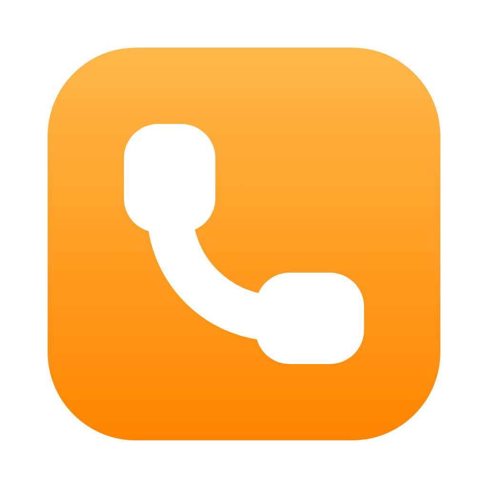
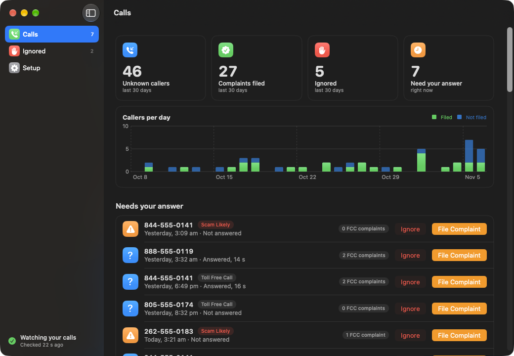
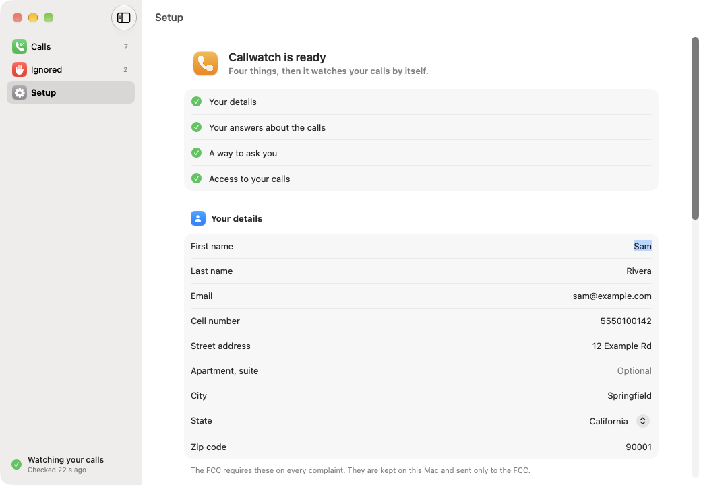

# Callwatch

Callwatch is a Mac app that notices robocalls to your iPhone and files the FCC complaint for you.

Your iPhone already syncs its call log to your Mac. When a number that is not in your contacts, and
that you have never called, rings your phone, Callwatch looks up how many FCC complaints already name
that number, then either files a complaint or asks you first.

## What you need

- A Mac (macOS 14 or later, Apple silicon or Intel) and an iPhone signed in to the same Apple Account,
  so calls sync to the Mac
- A US phone number: complaints go to the FCC

## Install

1. Download `Callwatch-1.0.dmg` from the [Releases page](https://github.com/rkoh46/callwatch/releases).
2. Open it and drag Callwatch to Applications.
3. Open Callwatch. It is not signed with a paid Apple developer certificate, so the first time macOS
   says it cannot verify the app: open System Settings, Privacy & Security, scroll down and press
   **Open Anyway**.

The app opens on its Setup page, with a checklist at the top:

1. **Your details.** The FCC requires a name, address, email and phone number on every complaint.
2. **Your answers about the calls.** The form asks what kind of call it was. You choose the answers once.
3. **A way to ask you.** An iMessage to yourself (reply `1` to file, `2` to ignore), or a notification
   on the Mac with File and Ignore buttons. For iMessage, send yourself one message from the Mac
   first; Setup has a button for it. **Send a Test Question** proves the round trip without filing
   anything.
4. **Access to your calls.** macOS only lets apps with Full Disk Access read the call log and your
   replies in Messages. Setup opens the right list; switch Callwatch on, then quit and reopen it.

Callwatch keeps watching from the menu bar after you close its window. Setup has a switch to open it
when you log in.

### Build it yourself

With Xcode installed:

    git clone https://github.com/rkoh46/callwatch.git
    cd callwatch
    ./build.sh
    open ~/Applications/Callwatch.app

`./release.sh 1.0` makes the DMG in `dist/`.

## How it decides

- **Likely robocall:** the FCC already has 3 or more complaints on the number, or your carrier labels
  the call as spam. You can let these be filed without asking (off by default).
- **Unsure:** you are asked. File the complaint, or ignore the number so it never asks again.
- **Likely, with automatic filing on:** you are told when it will be filed (30 minutes later by
  default). Ignore the number in that time to stop it. A call you talked on for 30 seconds or more is
  always asked about instead.
- People in your contacts, numbers you have called, and numbers you ignored are never reported.

## Read this before you turn it on

- **Each complaint is a sworn statement.** The FCC form ends with a declaration under penalty of
  perjury. Callwatch files with the answers you chose in Setup, so choose answers that are true for
  the calls you report, and think before letting it file calls you never heard.
- **Caller ID is often faked.** The number on your screen may belong to someone innocent.
- **The FCC does not act on single complaints.** It uses them in bulk to pick enforcement targets.
  Filing will not stop the calls by itself.
- Callwatch files at most 5 complaints an hour.

## How it files

Callwatch opens the FCC's own complaint form in a web view (the same engine as Safari), with the call's
date, time and number filled in through the form's address, types in your details, ticks the
attestation box and presses Submit. If the site shows a check that needs a person, filing stops and the
app tells you; "Show Form" in the app shows the page.

## Privacy

Everything stays on your Mac: settings in `~/Library/Application Support/Callwatch/config.json`,
history in `state.db` next to it. Callwatch talks to three places: the FCC's public complaint data (to
look up a caller's number), the FCC complaint site (to file, with your details), and Messages on this
Mac when you chose iMessage (the questions go to your own address through Apple).

## Code

- `Sources/Core.swift`: the synced call log and Contacts (read-only), history, FCC complaint counts
- `Sources/Engine.swift`: the watch loop, scoring, asking and filing
- `Sources/Filer.swift`: the FCC form in a web view
- `Sources/Notifier.swift`: iMessage to yourself (replies are read from the Mac's Messages history) and Mac notifications
- `Sources/Views.swift`, `App.swift`, `Settings.swift`: the window, menu bar item and settings

`CALLWATCH_DEMO=<folder>` runs the app on the `config.json` and `state.db` in that folder without
watching anything. `CALLWATCH_FILL_TEST=1` fills the real FCC form for a made-up call, does not send it,
prints the result and quits.

## Uninstall

    ./uninstall.sh          # keeps your settings and history
    ./uninstall.sh --all    # removes those too

## License

MIT. Callwatch is not affiliated with the FCC.
